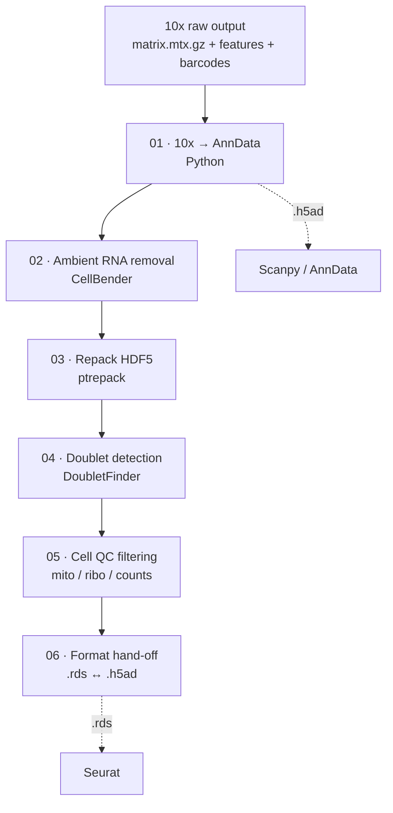

# snRNA-seq Preprocessing & QC Pipeline

A reproducible preprocessing and quality-control pipeline for 10x Genomics
single-nucleus RNA-seq (snRNA-seq) data. It takes raw per-sample count
matrices through ambient-RNA removal, doublet detection and cell-level
filtering, and hands off a clean object to either Scanpy (Python) or Seurat (R).

Built for multi-sample cohorts where every step needs to be re-runnable,
logged, and applied identically across samples.


---

## Pipeline overview



Each stage reads from the previous stage's directory and writes its own, so a
failed run can be resumed from the last successful step rather than restarted.

---

## Why these steps, in this order

The ordering is deliberate and matters more than it looks:

1. **Ambient RNA removal before doublet detection.** CellBender estimates and
   subtracts the cell-free RNA soup. Running DoubletFinder first would let
   ambient contamination inflate the neighbourhood graph and produce
   unreliable doublet calls.
2. **Doublets before cell-level QC.** Doublets have roughly double the UMI
   count of a real cell; filtering on `nCount_RNA` first can therefore
   selectively delete genuine doublets and leave borderline ones behind.
3. **Gene symbols preserved, not discarded.** The 10x `features.tsv.gz`
   carries both an Ensembl ID and a gene symbol. Many conversions keep only
   column one and silently lose every symbol, which makes downstream marker
   inspection painful. Step 01 keeps both.

---

## Requirements

| Component | Version | Used by |
|-----------|---------|---------|
| Python | ≥ 3.10 | steps 01, 02, 06a |
| R | ≥ 4.3 | steps 04, 05, 06b |
| CellBender | ≥ 0.3.2 | step 02 |
| PyTables (`ptrepack`) | ≥ 3.8 | step 03 |
| Seurat | ≥ 4.3 | steps 04, 05, 06b |
| DoubletFinder | GitHub `main` | step 04 |
| SeuratDisk | GitHub `main` | step 06b |

A CUDA-capable GPU is strongly recommended for step 02. CellBender on CPU
works but is roughly an order of magnitude slower per sample.

---

## Installation

```bash
git clone https://github.com/rufaq955/snrna-preprocessing-qc.git
cd snrna-preprocessing-qc

# Python environment (includes CellBender and ptrepack)
conda env create -f environment.yml
conda activate snrna-preprocessing-qc

# R dependencies
Rscript scripts/install_r_deps.R
```

---

## Usage

### 1. Describe your samples

```bash
cp config/samples.example.tsv config/samples.tsv
# edit: one row per sample, columns `name` and `directory`
```

`config/samples.tsv` is gitignored — real sample identifiers should stay local.

### 2. Run the pipeline

```bash
bash run_pipeline.sh --samples config/samples.tsv --outdir data --cuda
```

Or run individual steps:

```bash
python scripts/01_10x_to_h5ad.py --samples config/samples.tsv --outdir data/interim/h5ad
python scripts/02_cellbender_remove_background.py --indir data/interim/h5ad \
                                                 --outdir data/interim/cellbender --cuda
bash   scripts/03_ptrepack_for_r.sh
Rscript scripts/04_doubletfinder.R
Rscript scripts/05_qc_filter.R --mode before
Rscript scripts/05_qc_filter.R --mode after
```

Every script accepts `--help`.

---

## Stages

| Step | Script | Input | Output | Key parameters |
|------|--------|-------|--------|----------------|
| 01 | `01_10x_to_h5ad.py` | 10x `raw_matrix/` | `*.h5ad` | `--workers` |
| 02 | `02_cellbender_remove_background.py` | `*.h5ad` | `*_cellbender_filtered.h5` | see below |
| 03 | `03_ptrepack_for_r.sh` | `*_cellbender_filtered.h5` | `*_R.h5` | `--complevel 5` |
| 04 | `04_doubletfinder.R` | `*_R.h5` | `*_Doublet.rds` | `--doublet-rate`, `--pcs`, `--pn` |
| 05 | `05_qc_filter.R` | `*_Doublet.rds` | `*_qc.rds` | `--min-features`, `--max-mt`, … |
| 06 | `06a`/`06b` | `.h5ad` | `.rds` | — |

### CellBender parameters (step 02)

| Flag | Value | Rationale |
|------|-------|-----------|
| `--projected-ambient-count-threshold` | 5 | Counts below this are treated as ambient |
| `--learning-rate` | 1e-4 | Conservative; stabilises the ELBO |
| `--training-fraction` | 0.9 | Standard hold-out |
| `--low-count-threshold` | 20 | Cells below this are excluded from training |
| `--epochs` | 150 | Sufficient for convergence on typical snRNA-seq depth |
| `--posterior-batch-size` | 200 | Memory/throughput trade-off |

### QC thresholds (step 05)

| Metric | Threshold | Rationale |
|--------|-----------|-----------|
| `nFeature_RNA` | > 200 | Removes empty droplets and debris |
| `nCount_RNA` | > 500 | Removes low-complexity cells |
| `nCount_RNA` | < 10,000 | Removes probable doublets / outliers |
| `percent.mt` | ≤ 10 | Removes stressed or lysed nuclei |

These are the defaults for this cohort. They are exposed as CLI flags because
the right cut-offs depend on tissue, nuclei isolation protocol and sequencing
depth — they should not be treated as universal constants.

> **Note on snRNA-seq vs scRNA-seq:** nuclei have far lower mitochondrial
> content than whole cells, so the usual 20–25% mito ceiling is far too
> permissive here. The 10% default reflects that.

---

## Outputs

```
data/
├── interim/
│   ├── h5ad/          per-sample AnnData objects
│   ├── cellbender/    ambient-corrected HDF5
│   ├── r_h5/          Seurat-compatible HDF5
│   ├── doublets/      singlet-only .rds + doublet_summary.csv
│   └── meta/          metadata CSVs for the R hand-off
└── qc/                filtered .rds + qc_summary_before/after.csv
```

`doublet_summary.csv` and `qc_summary_*.csv` record per-sample cell counts
before and after each filter, which is what you need for a methods section.

---

## Data

**No data is included in this repository.** The pipeline is code only.

Raw and processed matrices from human samples cannot be redistributed, and
even de-identified count matrices are frequently subject to institutional
data-use agreements. To run the pipeline on your own data, point
`config/samples.tsv` at your local 10x output directories.

For a quick functional test without real data, `data/README.md` describes how
to generate a small synthetic 10x-format dataset.

---

## Reproducibility notes

- Every step logs to `logs/` with timestamps and the full command line used.
- Steps 02–05 skip samples whose output already exists, so interrupted runs
  resume rather than restart.
- Parameters live on the command line, not buried in the code, so a run can be
  reconstructed from the log alone.

---

## Citation

If this pipeline is useful in your work, see [`CITATION.cff`](CITATION.cff).

## License

MIT — see [`LICENSE`](LICENSE).

## Contact

Rufaq Ullah — rufaqullah@genomics.cn
